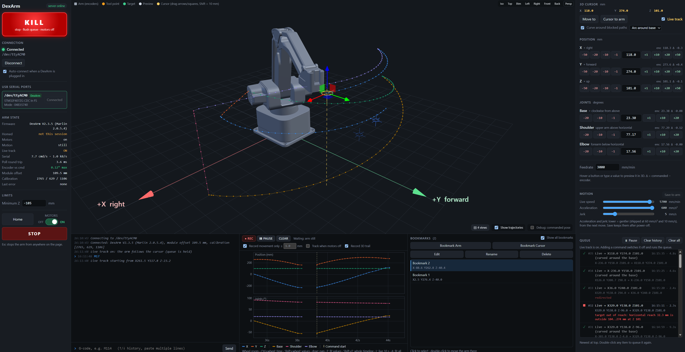
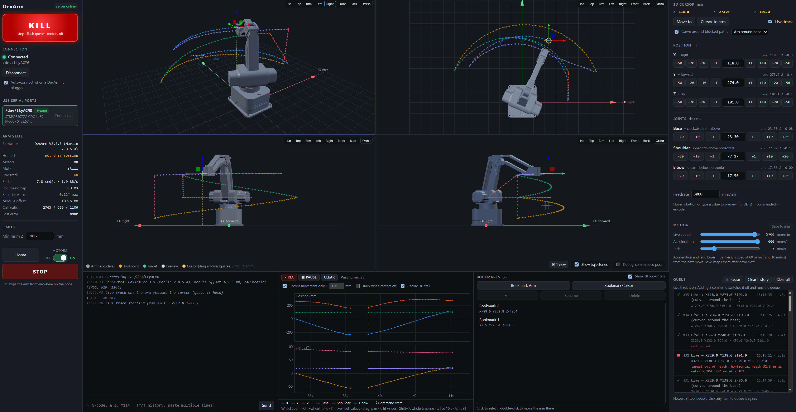

# dexarm-web

## Background

I purchaed a Rotrics DexArm on Kickstarter back in 2019. I dusted it off recently now in 2026 but it didn't have the software support I needed so I put together this web interface that runs on Linux. It's quite rudimentary, doesn't have support for grabbers or complex sequences, but enough to build upon. It would be fun to extend this into an MCP server for agents to talk to and add some vision and capabilites to hook into inferred intelligence. 

## What it is

A web control panel for the **Rotrics DexArm** robot arm. Plug the arm into a Linux machine over USB, start the
server, and control it from a browser. You get a live 3D view of the arm, a draggable 3D cursor the arm can follow,
jogging, a command queue, bookmarks, and graphs of where the arm went.

<p align="center">
  
</p>

- **See the arm:** a 3D model driven by the arm's own encoders, in one view or four (iso, top, front, side…).
- **Move it:** jog buttons, typed coordinates, or drag the 3D cursor and press **Move to**, or turn on
  **Live track** to have the arm follow it.
- **Stay safe:** every move is checked against the arm's reach and a minimum height before it is sent.
  STOP (Esc) and a KILL switch are always on screen.
- **Remember and review:** bookmarks, a queue history you can replay, a graph of positions and joint angles,
  and a 3D trail of every move.

## Getting started

You need a DexArm on USB and a Linux machine with `curl`. 

You also need to be able to run sudo on your machine, because serial port access is blocked by default to regular users.

The scripts install everything else.

```bash
git clone https://github.com/<you>/dexarm-web.git
cd dexarm-web
./install.sh       # one time: Python environment, 3D libraries, the arm's 3D model
./run_server.sh    # start the server (runs install.sh first if anything is missing)
```

Open **http://localhost:8080**, or `http://<machine>:8080` from another computer. The arm is found and connected
automatically. Press **Home** before your first move.

`install.sh` is safe to run again; it skips what's already there. It installs [uv](https://docs.astral.sh/uv/)
if you don't have it, uses npm and git if they're available (and downloads directly if not), and tells you if your
user can't access the serial port yet. `run_server.sh` passes options through, e.g. `./run_server.sh --port 9000`.

### Security alert: The sever is open by default
> The server has **no login and listens on your whole network**, so anyone on it can move the arm.
> Run `./run_server.sh --host 127.0.0.1` to keep it to this machine.

> Ensure you are on a trusted network and that your firewall blocks out any unwanted access.

### Install and run manually

The same steps by hand (needs [uv](https://docs.astral.sh/uv/), npm and git):

```bash
uv sync                                  # Python environment in .venv
npm install                              # three.js and urdf-loader into node_modules
git clone --depth 1 https://github.com/Rotrics-Dev/URDF-of-DexArm vendor/URDF-of-DexArm   # 3D model
sudo usermod -aG dialout $USER           # serial port access; log out and back in once
uv run dexarm-web                        # start the server
```

## Resources

This repo contains only the web app. Everything else comes from Rotrics:

| What | Where |
|---|---|
| Product site | [rotrics.com](https://rotrics.com/) |
| Official firmware images and Rotrics Studio | [rotrics.com/pages/downloads](https://rotrics.com/pages/downloads) (we used *DexArm Firmware V2.3.5*, a zip with images for hardware V3.1 and V3.2) |
| User manual and G-code reference | [manual.rotrics.com](https://manual.rotrics.com/) |
| All source code | [github.com/Rotrics-Dev](https://github.com/Rotrics-Dev) |
| Firmware source code (a Marlin fork). Not needed to run the app; we read it to port the kinematics and find the bugs below | [Marlin_For_DexArm](https://github.com/Rotrics-Dev/Marlin_For_DexArm) |
| 3D model used by the 3D view | [URDF-of-DexArm](https://github.com/Rotrics-Dev/URDF-of-DexArm), downloaded by `install.sh` |
| Official desktop app (also does firmware updates) | [rotrics-studio-app](https://github.com/Rotrics-Dev/rotrics-studio-app) |
| Python API examples | [DexArm_API](https://github.com/Rotrics-Dev/DexArm_API) |

## How it works

**The screen.**
- **Left panel:** connection, arm state, minimum Z, Home, the Motors switch, STOP and KILL.
- **Middle:** the 3D view, with a console, a graph and bookmarks below it.
- **Right panel:** the 3D cursor, jog buttons, motion settings and the queue.

<p align="center">
  
</p>

**Moving the arm.**
- Drag the cursor either on one axis or on a plane. 
- While you drag, guides show how far the arm can reach along that axis or that plane
- A dashed line previews the route the arm will take.
- All commands goes into the **queue** and are executed in order. 
- Double-click a past entry to run a command again again. Live-track moves are logged there too.
- The **3D cursor** has drag handles. 
- If the straight line to a target passes somewhere the arm can't reach, such as the area right next to its base,
  the move **curves around the base** instead. This can be switched off.
- **Bookmarks** save the arm or cursor position. Double-click one to go there. They're stored in `bookmarks.yaml`.

**Safety.**
- **STOP** (or Esc) halts the arm immediately and cancels the queue. The motors keep holding the arm.
- **KILL** does the same, then releases the motors and refuses every command until you press it again.
  The arm can sag when released.
- **Minimum Z** (default −105 mm) keeps the arm out of the table. Nothing is ever sent below it.
- Jog buttons that would leave the reachable area turn red and stop at the edge instead.

## Under the hood

 A Python server (FastAPI, pyserial) owns the serial port. It streams each move to the arm in
short pieces, polls the position about four times a second, and pushes everything to the browser over a
WebSocket. 

The front end is plain JavaScript with three.js, with no build step. Each run writes a log to
`logs/`, including the last raw serial traffic if the connection drops.

## Issues we ran into

| Problem | Cause | Fix |
|---|---|---|
| The base stalled against its end stop when homing | The base encoder's zero point was exactly 90° off after I had disassembled it to clean and lubricate the base gearbox. | Recalibrated in software with `M889`, no disassembly. See [the notes](docs/dexarm-notes.md#calibration) |
| The arm froze and needed a power cycle | A bug in firmware V2.2.2: `M410` (quick stop) could wedge the USB serial port, and the watchdog is off, so it never recovers | Updated to the official V2.3.5 image from the [Rotrics downloads page](https://rotrics.com/pages/downloads), flashed through the arm's bootloader with [`tools/flash_dexarm.py`](tools/flash_dexarm.py) (Rotrics Studio can do the same) |
| Moves stuttered, and "+1 mm" sometimes moved much more | Another V2.2.2 bug: reading the encoders (`M895`) during a move resets the firmware's position mid-move. The firmware's idea of the position also goes stale after the arm is moved by hand | The same firmware update. The app also resyncs the firmware from the encoders (`M17`) before each move and refuses to move if they disagree |
| Moves silently stopped short | The firmware cuts off any move that leaves its reach table, without an error | The app checks every move's whole path first, with a 1.5 mm safety margin |
| Jerky motion when streaming | Gaps between pieces let the firmware's 80 ms buffer run dry | The next piece is always queued while the current one runs, with at most 4 commands in flight |
| The arm could reach below the table | The firmware's limits allow down to Z −127 mm | A user-set minimum Z, enforced on every move |
| Moves after STOP were refused | Firmware V2.3.5 requires homing after a quick stop | Press Home after STOP |

More detail on the firmware (G-codes, kinematics, the update procedure) is in
[`docs/dexarm-notes.md`](docs/dexarm-notes.md).

## Options

```
./run_server.sh --host 127.0.0.1 --port 8080 --urdf /path/to/URDF-of-DexArm/URDF
```

`DEXARM_URDF_DIR` can be used instead of `--urdf`. Tested with DexArm hardware V3.2 and firmware V2.3.5 on Linux.

## License

GPL-3.0-or-later (see [LICENSE](LICENSE)), because the kinematics and reach table are derived from Rotrics'
GPL-3.0 firmware. The 3D model (MIT), three.js (MIT) and urdf-loader (Apache-2.0) are downloaded at setup, not
included. Not affiliated with Rotrics.
